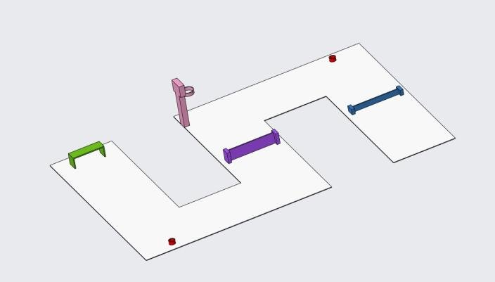
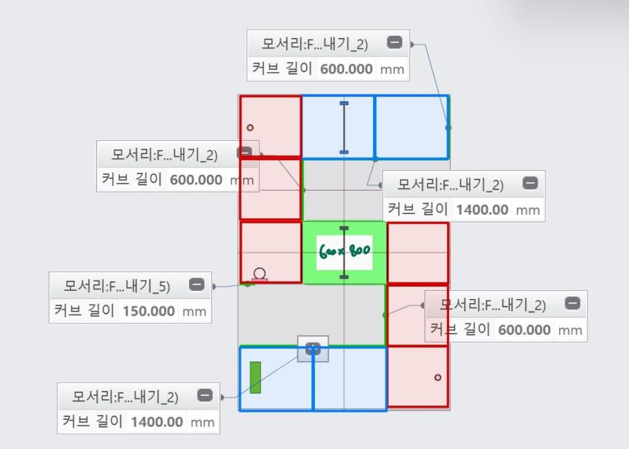
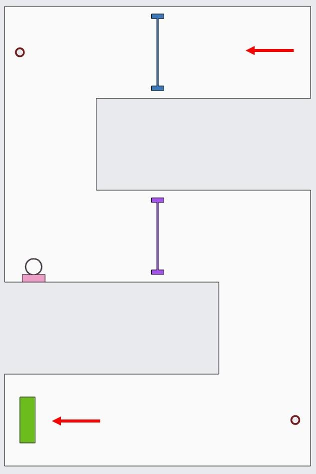
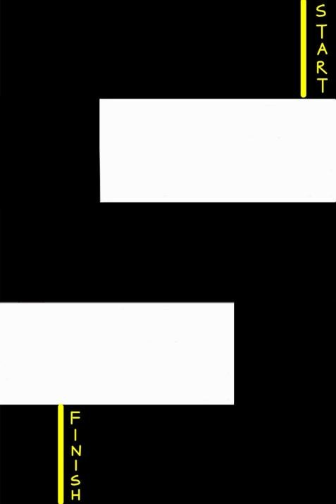
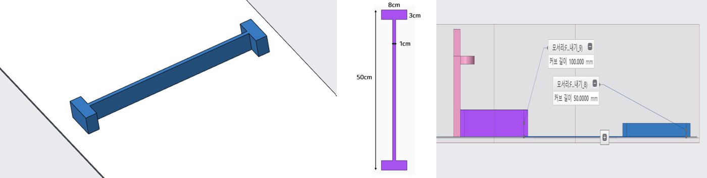
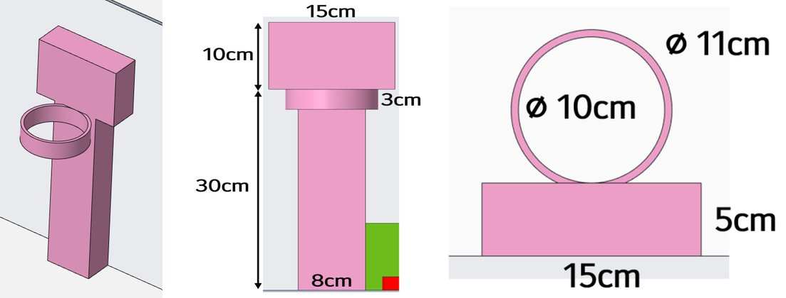
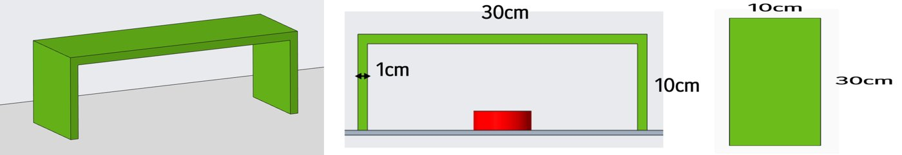
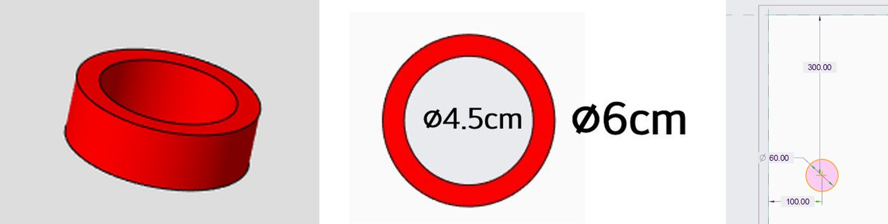

# Arena Setup

!!! abstract "요약"
    - 경기장 2 m × 3 m, 폭 60 cm의 S자 경로 — 휴대 · 보관을 위해 **X배너 PET에 인쇄**해 말아서 운반
    - 코스: START → ① 허들 5 cm → ② 농구 → ③ 허들 10 cm → ④ 축구 → FINISH
    - 소품(허들 · 농구 골대 · 축구 골대 · 공 지지대)은 **3D 프린팅**, 공은 지름 7 cm 스펀지공
    - 미션 수행 로직 → [Task Generation](task/index.md), 목표물 인식 → [High Level Control](vision/index.md)

<figure markdown="span">
  { width="640" }
  <figcaption>경기장 3D 모델 (도면 색은 부분 구별용 — 실제 색은 <a href="#props">소품</a> 표 참고)</figcaption>
</figure>

## 1. 경기장 바닥

### 구역 · 치수

<figure markdown="span">
  { width="560" }
  <figcaption>구역 치수 (mm)</figcaption>
</figure>

<figure markdown="span">
  { width="320" }
  <figcaption>소품 배치 · 진행 방향 (화살표)</figcaption>
</figure>

| 항목 | 값 |
|---|---|
| 전체 | 2 m × 3 m |
| 경로 폭 | 60 cm |
| 안쪽 돌출부 (경로 밖) | 140 cm × 60 cm, 좌우 번갈아 2개 → S자 경로 |
| 구역 | 직사각형 60 × 70 cm, 정사각형 60 × 60 cm, 가운데 60 × 80 cm |
| 진행 | 오른쪽 위 START → 왼쪽 아래 FINISH |

### 인쇄 도안

<figure markdown="span">
  { width="300" }
  <figcaption>인쇄 도안 — 검은색: 경로, 흰색: 경로 밖</figcaption>
</figure>

| 항목 | 내용 |
|---|---|
| 재질 | X배너 PET — 말아서 운반해도 구겨지지 않음 → 장소를 옮겨 실험 가능 |
| 제작 | 2 m × 3 m 인쇄 주문 제작 |
| 경로 · 바깥 | 검은색 · 흰색 |
| START · FINISH | 노란색 선 + 글자 (인쇄) |
| 로고 (RH+ · 학교) | 인쇄하지 않고 흰색 영역에 스티커 — 장애물 · 경로 색과 겹치면 비전 검출에 방해 |

## 2. 소품 { #props }

| 소품 | 색 (제작) | 규격 | 위치 |
|---|---|---|---|
| 허들 1 | 파랑 | 높이 5 cm | 첫 번째 직선 구간 |
| 허들 2 | 초록 | 높이 10 cm | 가운데 직선 구간 |
| 농구 골대 | 파랑, 림 검정, 백보드 빨간 사각형 (또는 AprilTag) | 아래 표 | 경로에서 15 cm (림 중심 기준 19 cm) |
| 축구 골대 | 초록 | 30 × 10 × 10 cm | 마지막 구간 왼쪽 벽에서 10 cm |
| 공 지지대 | 초록 | 외경 6 cm, 내경 4.5 cm, 높이 3 cm | 2개 (농구 · 축구). 실험하며 조정 |
| 공 | — | 지름 7 cm, 12~13 g, 스펀지 | 공 지지대 위 |

- 소품은 모두 3D 프린팅 — 색은 동아리방에서 쓸 수 있는 필라멘트 색 기준
- 인식에 쓰는 색 → [Object Detection](vision/detection.md)

### 허들

<figure markdown="span">
  
  <figcaption>허들 — 3D · 위에서 본 모양 · 높이 비교 (도면 색은 구별용)</figcaption>
</figure>

| 항목 | 값 |
|---|---|
| 길이 | 50 cm |
| 양 끝 받침 | 8 × 3 cm |
| 가로대 두께 | 1 cm |
| 높이 | 허들 1: 5 cm, 허들 2: 10 cm |

### 농구 골대

<figure markdown="span">
  
  <figcaption>농구 골대 — 3D · 옆 · 위에서 본 모양 (도면 색은 구별용)</figcaption>
</figure>

| 항목 | 값 |
|---|---|
| 기둥 | 높이 30 cm, 폭 8 cm |
| 림 | 내경 10 cm, 외경 11 cm, 높이 3 cm |
| 백보드 | 15 × 10 cm, 두께 5 cm |

### 축구 골대 · 공 지지대

<figure markdown="span">
  
  <figcaption>축구 골대 — 3D · 앞 · 위에서 본 모양</figcaption>
</figure>

<figure markdown="span">
  
  <figcaption>공 지지대 — 3D · 위에서 본 모양 · 위치 예 (벽에서 300 mm · 100 mm)</figcaption>
</figure>

## 3. 경기 규칙 { #rules }

| 항목 | 규칙 |
|---|---|
| 진행 | 자율 주행으로 트랙 완주. START 선 뒤에서 출발, FINISH 선 통과 시 종료 |
| 제한 시간 | 10분 |
| 조작 | 경기 중 명령 · 신호 · 접촉 금지 |
| 허들 | **전진 보행**으로 넘기. 넘어뜨리기 · 넘지 않기 · 옆걸음으로 넘기 → 실격 |
| 경로 | 경기장 · 정해진 경로 이탈 시 종료 |
| 순위 | 미션 점수 → 총 이동 거리 → 시간 |

| 미션 | 내용 | 점수 |
|---|---|---|
| 농구 | 공 지지대 위의 공을 잡아 농구 골대에 넣기. 방법 자유 | 골 +1, 림 접촉 −1 |
| 축구 | 공 지지대 위의 공을 드리블해 **하체로** 슛 | 골 +1, 골대 접촉 · 하체 외 부위로 공을 움직임 −1 |

- 미션 점수 범위: −2 ~ +2. 감점은 골대당 1회
- 바닥에 떨어진 공은 다시 주울 수 있음. 경기장 밖으로 나간 공은 다시 가져올 수 없음
