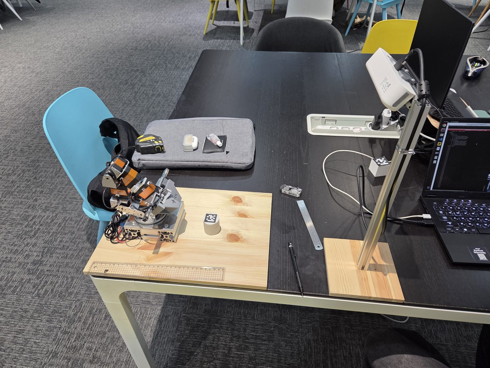
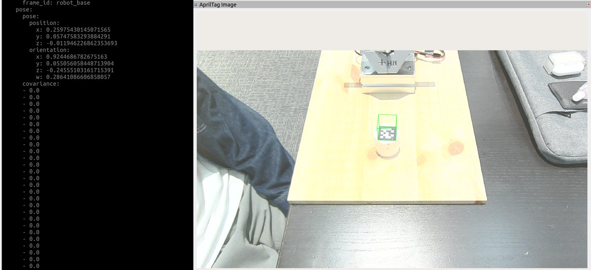
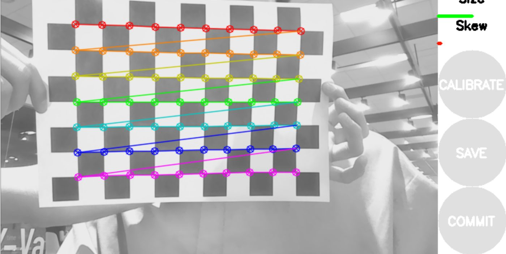
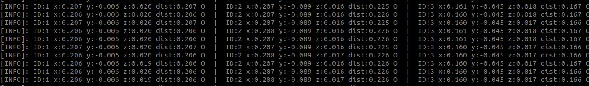

# AprilTag Integration

!!! abstract "요약"
    - 작업대 위 고정 카메라로 AprilTag를 검출해 **로봇 베이스 좌표계 위치**를 `/apriltag_detections`로 발행
    - 좌표 변환: 카메라 → 로봇 베이스 (측정한 카메라 위치 · 기울기) → **Kabsch 보정** (실측 기준점으로 남은 오차 제거)
    - 결과: 보정 후 mm 단위에 가까운 좌표 → [Pick & Place](pick-place.md)의 실린더 적층에 사용
    - 소스: [`RHp_apriltag_ros2`](https://github.com/RHplusLab/RHp_apriltag_ros2) · [`RHp_apriltag_msgs`](https://github.com/RHplusLab/RHp_apriltag_msgs)

## 구조

```text
웹캠 (작업대 위 고정, 비스듬히 아래를 봄)
   │ cv2.VideoCapture, 1920 × 1080
   ▼
apriltag_webcam_node
   ├─ 태그 검출 (tag25h9)            → ID · 픽셀 중심 · 꼭짓점
   ├─ 자세 추정 detection_pose()     → T_co   카메라 기준 태그 자세
   └─ construct_transform()          → T_bo   로봇 베이스 기준 태그 자세
   │
   ├─ /apriltag_detections   (AprilTagDetectionArray)
   └─ /apriltag_image        (검출 결과를 그린 영상, RViz 확인용)
   ▼
vision_cylinder_one / vision_cylinder_stack (MTC)   ·   apriltag_processor_node (배치 확인)
```

<figure markdown="span">
  { width="640" }
  <figcaption>작업대 위 고정 카메라 · 로봇팔 · 태그 큐브</figcaption>
</figure>

<figure markdown="span">
  
  <figcaption>왼쪽: <code>/apriltag_detections</code>의 로봇 베이스 기준 위치 · 오른쪽: <code>/apriltag_image</code> (태그 위에 큐브 표시)</figcaption>
</figure>

## 1. 패키지

| 리포 | 내용 |
|---|---|
| `RHp_apriltag_ros2` | 검출 노드 (Python). 웹캠용 `apriltag_webcam`, RealSense용 `apriltag_realsense` |
| `RHp_apriltag_msgs` | 메시지 정의 |

| 브랜치 | 시점 | 내용 |
|---|---|---|
| `main` | 2025-03 | 초기 버전. 카메라 파라미터 · 변환값이 예시값 |
| **`astraplus`** | 2025-07-14 | **로봇팔 작업에 실제 사용한 값** (아래 표는 모두 이 브랜치 기준) |

```bash
cd ~/ros2_ws/src
git clone -b astraplus https://github.com/RHplusLab/RHp_apriltag_ros2.git
git clone https://github.com/RHplusLab/RHp_apriltag_msgs.git
pip install apriltag opencv-python numpy scipy
cd ~/ros2_ws && colcon build && source install/setup.bash
```

- `requirements.txt`에 `pyrealsense2`도 있음 — 웹캠만 쓰면 없어도 됨
- `utils.py`가 `scipy`를 쓰지만 `requirements.txt`에는 없음 → 따로 설치

### 메시지

```text
# AprilTagDetectionArray.msg
std_msgs/Header header
AprilTagDetection[] detections

# AprilTagDetection.msg
string family
int32 id
geometry_msgs/Point center                       # 픽셀 좌표 (x, y)
geometry_msgs/Point[4] corners                   # 꼭짓점 4개 픽셀 좌표
geometry_msgs/PoseWithCovarianceStamped pose     # 로봇 베이스 기준 자세 (frame_id: robot_base)
```

- 배열 header의 `frame_id`는 `camera_link`지만, 각 태그의 `pose`는 **이미 로봇 베이스 좌표로 변환된 값**

## 2. 검출 노드 설정

`src/rhp_apriltag_ros2/apriltag_webcam.py`

| 항목 | 값 (`astraplus`) | 비고 |
|---|---|---|
| 태그 패밀리 | `tag25h9` | |
| `tag_size` | **0.02828 m** | 출력한 태그의 실제 크기 (`main`은 0.04) → [트러블슈팅](#troubleshooting) |
| 카메라 장치 | `cv2.VideoCapture(4, cv2.CAP_V4L2)` | 장치 번호는 PC마다 다름 (`ls /dev/video*`로 확인) |
| 해상도 · fps | 1920 × 1080, 30 | |
| `cam_params_rgb` | (1422.84, 1428.16, 951.57, 547.72) | fx, fy, cx, cy — 1920 × 1080 기준 |
| 검출 주기 | 30 Hz 타이머 | |
| `surface_offset` | 파라미터, 기본 `0.0,0.0` | 로봇 베이스를 옮겼을 때 x · y 보정 (m) |

```bash
ros2 launch rhp_apriltag_ros2 apriltag_webcam.launch.py                        # 검출 노드 + RViz
ros2 launch rhp_apriltag_ros2 apriltag_webcam.launch.py surface_offset:="0.05,0.0"
```

- 실린더 · 큐브 윗면에 붙인 태그 ID 1~3 사용 — 0번은 쓰지 않음 → [Pick & Place › 트러블슈팅](pick-place.md)

## 3. 카메라 내부 파라미터

fx, fy, cx, cy — 상이 맺힐 때 렌즈 초점거리와 중심의 오차를 보정하는 값

```bash
sudo apt install ros-humble-camera-calibration ros-humble-usb-cam
ros2 run usb_cam usb_cam_node_exe                       # /image_raw 발행
ros2 run camera_calibration cameracalibrator --size 7x10 --square 0.0245 \
  --ros-args -r image:=/image_raw
```

<figure markdown="span">
  { width="640" }
  <figcaption>cameracalibrator — 체커보드 교차점 검출</figcaption>
</figure>

| 항목 | 값 |
|---|---|
| 체커보드 | A4 출력, 칸 11 × 8 |
| `--size` | **내부 교차점 수** 7x10 (칸 수 11 × 8이 아님) |
| `--square` | 칸 한 변 0.0245 m |

- 참고: [Offline camera calibration in ROS 2](https://medium.com/starschema-blog/offline-camera-calibration-in-ros-2-45e81df12555)

## 4. 카메라 → 로봇 베이스 변환

`utils.py`의 `construct_transform()`

```text
T_bo = T_calib · T_surface · T_bc · T_co

T_co       카메라 기준 태그 자세 (detection_pose 결과)
T_bc       로봇 베이스 기준 카메라 자세 (실측)
T_surface  로봇 베이스 이동 보정 (surface_offset)
T_calib    Kabsch 보정 (5절)
```

### T_bc — 카메라 위치 · 기울기 { #camera-pose }

```python
camera_offset = np.array([0.507, 0.013, 0.383])     # 로봇 베이스 기준 카메라 위치 (m)

R_flip_xz = np.array([[1, 0, 0],
                      [0, -1, 0],
                      [0, 0, -1]])                   # y, z 뒤집기 (카메라 → 베이스 축 방향)

angle_rad = np.arccos(0.853131)                     # 카메라 z축 ↔ 베이스 z축 사이 각 (약 31.4°)
R_tilt = R.from_rotvec(angle_rad * np.array([0, 1, 0])).as_matrix()   # y축(pitch) 회전

R_bc = R_tilt @ R_flip_xz
```

| 값 | 구하는 법 |
|---|---|
| `camera_offset` | 로봇 베이스 원점 기준 카메라 위치 실측값 |
| `angle_rad` | 카메라가 수직축에 대해 기울어진 각도. 코드에는 cos 값으로 넣음 |
| `R_flip_xz` | y · z 축 부호 반전 |

실측값만으로는 오차가 남는다 → 5절 보정으로 없앤다.

## 5. Kabsch 보정 { #kabsch }

알고 있는 위치에 태그를 놓고 **측정값(SRC) ↔ 실제값(TGT)** 쌍을 모아, 둘을 가장 잘 맞추는 회전 + 이동 `T_calib`을 구한다.

```text
1. 두 점 집합의 중심 c_src, c_tgt
2. 각각 중심을 원점으로 이동
3. 교차 공분산 H = srcᵀ · tgt
4. SVD: H = U S Vᵀ  →  R = V Uᵀ   (det(R) < 0 이면 V 마지막 행 부호 반전 — 반사 방지)
5. t = c_tgt − R · c_src
```

- 함수: `calibrate_rigid_3d(pts_src, pts_tgt)` → 4 × 4 행렬
- 회전 + 이동만 구함 (크기 변환 없음)
- 점 수: 4개 이상 권장 (코드는 5개 사용)

### 보정 절차

1. `T_calib` 적용 없이(보정 전) 검출 노드 실행
2. 작업대 위 **좌표를 아는 위치**에 태그를 하나씩 놓고 출력 위치 기록 → `CALIB_SRC`
3. 같은 순서로 실제 위치 기록 → `CALIB_TGT`
4. `utils.py`에 두 배열을 넣고 다시 빌드

```python
CALIB_SRC = np.array([          # 보정 전 출력 (m)
    [0.243, 0.098,  -0.035],
    [0.259, 0.0546, -0.010],
    [0.288, 0.099,  -0.064],
    [0.229, 0.144,  -0.064],
    [0.197, 0.101,  -0.0143],
])
CALIB_TGT = np.array([          # 실제 위치 (m)
    [0.15,  0.0,  0.04],
    [0.20,  0.0,  0.04],
    [0.15,  0.05, 0.04],
    [0.10,  0.0,  0.04],
    [0.15, -0.05, 0.04],
])
```

- 기준점: (0.15, 0) 중심의 십자 배치 — 앞뒤 · 좌우로 5 cm씩
- `z = 0.04`: 높이 4 cm 큐브 윗면을 원점으로 잡기 위한 값
- 작업대 틈 사이 간격 주의

## 6. 배치 확인 노드

`RHp_arm_controller` [`vision_cylinder` 브랜치](https://github.com/RHplusLab/RHp_arm_controller/tree/vision_cylinder/rhparm_mtc_pick_and_place)의 `apriltag_processor_node` — 태그 ID 순서대로 거리를 계산해 층별 적층 가능 여부를 판별한다.

```bash
ros2 run rhparm_mtc_pick_and_place apriltag_processor_node
#   ID:1 x:0.150 y:-0.050 z:0.015 dist:0.158 O  |  ID:2 ... X
```

<figure markdown="span">
  
  <figcaption>태그 3개 모두 허용 거리 안 (O)</figcaption>
</figure>

| 태그 ID (= 쌓을 층) | 허용 거리 `√(x² + y²)` |
|---|---|
| 1 (1층) | 0.10 ~ 0.21 m |
| 2 (2층) | 0.120 ~ 0.265 m |
| 3 (3층) | 0.135 ~ 0.260 m |

- 거리별 그리퍼 자세 → [Pick & Place › 접근 각도 표](pick-place.md#approach-angle)

## 트러블슈팅 { #troubleshooting }

| 증상 | 원인 | 해결 |
|---|---|---|
| `Cannot open camera. Retrying in 5 seconds...` 반복 | `VideoCapture` 장치 번호가 PC마다 다름 | `ls /dev/video*`로 확인 후 번호 수정 (예: 2 → 4) |
| 코드를 고쳐도 반영 안 됨 | 검출 노드를 두 명령으로 중복 실행 | 기존 노드 종료 후 launch 하나만 실행 |
| 위치 오차 | `tag_size`가 실제 태그 크기와 다름 (0.04 m) | 출력한 태그 크기로 수정 (0.02828 m) |
| x · y 오차 0.5 m 이상 (z는 정상) | 좌표축 방향 · 카메라 기울기 설정 오류 | 태그를 축별로 움직여 축 방향 확인 → [4절](#camera-pose) |
| 오차를 상수로 더해도 해결 안 됨 | 한 축 값을 바꾸면 다른 축 값도 함께 바뀜 (회전 오차) | Kabsch 보정 → [5절](#kabsch) |
| 보정 후에도 한 축(y) 오차 | 잘못된 보정값 | 보정 없이 출력을 다시 확인하고 SRC · TGT 재측정 |
