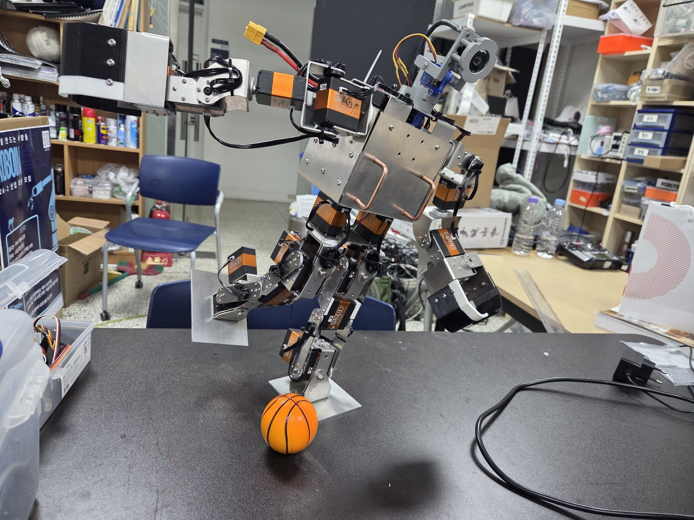

# RH+ Humanoid Project

Roboin Humanoid Plus — 22-DoF Humanoid and 7-DoF Manipulator, controlled with ROS2

{ .hero }

[시작하기](install/index.md){ .md-button .md-button--primary }
[GitHub :material-github:](https://github.com/RHplusLab){ .md-button }

---

-   :material-robot-industrial: **22축 휴머노이드**

    ---

    - **경기장 미션** — 허들 2개 · 농구 · 축구를 자율 수행 (개발 중)
    - **보행** — OP3 알고리즘 기반 사인파 보행 (실물 튜닝 중)
    - **인식** — 머리 카메라 색상 필터링으로 목표물 위치 추정 (개발 중)

-   :material-robot-outline: **7축 로봇팔**

    ---

    - **작업 계획** — MoveIt2 + MoveIt Task Constructor로 집기 · 옮기기 · 놓기를 단계별 계획
    - **Pick & Place** — 좌표를 받아 실린더를 집어 지정 위치에 놓기
    - **블럭 쌓기** — 카메라로 AprilTag 실린더 3개를 찾아 3층으로 적층

## 진행 상태

| 영역 | 상태 | 문서 |
|---|---|---|
| 하드웨어 인터페이스 | ✅ 24관절 `ros2_control` · Gazebo 연동 | [Hardware Interface](hw/index.md) |
| 보행 | ⚠️ Gazebo에서 방향 명령 동작, 실물 파라미터 튜닝 중 | [Walking Pattern](walk/index.md) |
| 카메라 · 인식 | ⚠️ 카메라 구동, 카메라 좌표계 3D 좌표 산출까지 | [High Level Control](vision/index.md) |
| 미션 수행 | ⬜ 상태 기계 설계 단계 | [Task Generation](task/index.md) |
| 강화학습 제어 | ⬜ 준비 중 | [RL Control](rl.md) |
| 7축 로봇팔 | ✅ AprilTag 실린더 3층 적층 | [7-DoF Manipulator](arm/index.md) |

## 기술 스택

| 영역 | 사용 기술 |
|---|---|
| OS / 미들웨어 | Ubuntu 22.04, ROS 2 Humble, CycloneDDS |
| 제어 | `ros2_control`, custom `hardware_interface`, MoveIt2 |
| 작업 계획 | MoveIt Task Constructor (MTC) |
| 시뮬레이션 | Gazebo, RViz |
| 인식 | AprilTag, HSV 색상 필터링 |
| 보행 | 사인파 기반 보행 패턴 (OP3 알고리즘 이식) |

## Documentation

-   **1 ·** [Installation](install/index.md)

    Ubuntu 22.04 + ROS 2 Humble 설치, 워크스페이스 구성

-   **2 ·** [Hardware Interface](hw/index.md)

    URDF description 패키지와 `ros2_control` 하드웨어 인터페이스

-   **3 ·** [Arena Setup](arena.md)

    2 m × 3 m 경기장과 미션 구성

-   **4 ·** [High Level Control](vision/index.md)

    카메라로 물체를 찾아 제어로 넘기기

-   **5 ·** [Walking Pattern](walk/index.md)

    사인파 기반 보행 패턴 생성 (OP3 알고리즘 이식)

-   **6 ·** [RL Control](rl.md)

    강화학습 기반 제어 — 준비 중

-   **7 ·** [Task Generation](task/index.md)

    보행 · 미션 동작을 엮어 경기장 미션 수행

-   :material-robot-outline: [7-DoF Manipulator](arm/index.md)

    MoveIt2 · MTC로 AprilTag 실린더 Pick & Place

-   :material-school: [Learning Path](study/index.md)

    제어 이론 커리큘럼 — 준비 중

---

연세대학교 기계공학부 로봇동아리 **Roboin** · 2025.03 ~
