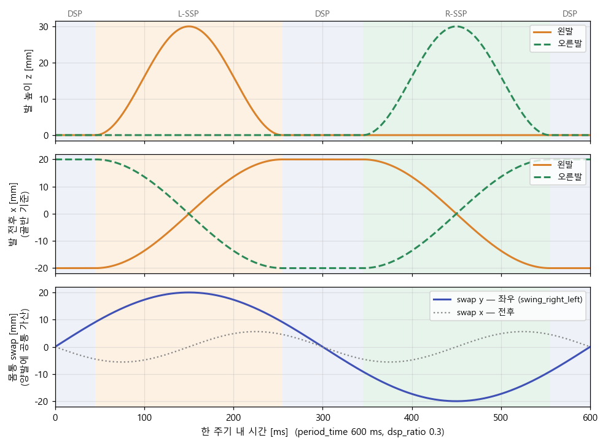

# Sine-Based Walking

!!! abstract "요약"
    - 소스: [`rhphumanoid_walking_module.cpp`](https://github.com/RHplusLab/RHp_humanoid_controller/blob/main/rhphumanoid_walking/src/rhphumanoid_walking_module.cpp), [`rhphumanoid_kinematics_dynamics.cpp`](https://github.com/RHplusLab/RHp_humanoid_controller/blob/main/rhphumanoid_walking/src/rhphumanoid_kinematics_dynamics.cpp)
    - 발 끝점 · 몸통 움직임을 **모두 사인파로 미리 계산** → IK → 관절각
    - 한 주기 = 양발 지지(DSP)와 외발 지지(SSP)를 번갈아 거치는 5구간
    - 계산 순서: 파라미터 → `wSin()` 발 끝점 → 닫힌 형태 IK → 골반 · 고관절 보정 → 30포인트 action

## 1. 사인파 함수 `wSin`

모든 궤적은 이 함수 하나로 만든다.

$$
\mathrm{wSin}(t,\ T,\ \phi,\ A,\ A_0) = A \sin\!\left(\frac{2\pi}{T}t - \phi\right) + A_0
$$

| 기호 | 의미 |
|---|---|
| \(t\) | 주기 안에서의 현재 시간 |
| \(T\) | 사인파 주기 (궤적마다 다름, 아래 표) |
| \(\phi\) | 위상 이동 |
| \(A\), \(A_0\) | 진폭, 진폭 이동(중심값) |

궤적은 두 종류로 나뉜다.

| 종류 | 대상 | 주기 \(T\) | 진폭 |
|---|---|---|---|
| **move** | 각 발 (x · y · z · yaw) | SSP 시간 (z는 그 절반) | 보폭 · 발 높이 |
| **swap** | 몸통 (양발 좌표에 공통으로 더함) | x · z: 주기의 절반, y: 한 주기 | `swing_right_left` 등 |

## 2. 한 주기의 5구간

`dsp_ratio`로 양발 지지 비율을 정하고, 나머지를 외발 지지에 쓴다. (`period_time` \(P\), `ssp_ratio` \(s = 1-\)`dsp_ratio`)

| 시점 | 식 | 기본값 (\(P\) = 600 ms, \(s\) = 0.7) |
|---|---|---|
| 왼발 스윙 시작 \(t_1\) | \((1-s)P/4\) | 45 ms |
| 왼발 착지 \(t_2\) | \((1+s)P/4\) | 255 ms |
| 오른발 스윙 시작 \(t_3\) | \((3-s)P/4\) | 345 ms |
| 오른발 착지 \(t_4\) | \((3+s)P/4\) | 555 ms |

```text
|─DSP─|───── L-SSP ─────|─DSP─|───── R-SSP ─────|─DSP─|
0     t1                t2    t3                t4    P
```

| 구간 | 왼발 | 오른발 | 몸통 |
|---|---|---|---|
| DSP (0 ~ \(t_1\)) | 고정 | 고정 | 좌우 이동 시작 |
| L-SSP (\(t_1\) ~ \(t_2\)) | **들어 올려 앞으로** | 지지 | 오른발 쪽으로 이동, 골반 기울임 |
| DSP (\(t_2\) ~ \(t_3\)) | 착지 | 고정 | 중앙으로 복귀 |
| R-SSP (\(t_3\) ~ \(t_4\)) | 지지 | **들어 올려 앞으로** | 왼발 쪽으로 이동, 골반 기울임 |
| DSP (\(t_4\) ~ \(P\)) | 고정 | 착지 | 다음 주기 준비 |

<figure markdown>
  
  <figcaption>전진 명령, 현재 YAML 값 기준 한 주기 궤적. 코드의 wSin 식을 그대로 옮겨 계산한 그래프</figcaption>
</figure>

- **발 높이 z**: 스윙 구간에서만 반원처럼 올라갔다 내려옴. 최대 높이 = `foot_height`
- **발 전후 x**: 스윙 발은 −`x_move_amplitude` → +`x_move_amplitude`, 지지 발은 반대로 → 골반이 앞으로 나아감
- **몸통 swap y**: 지지 발 쪽으로 무게중심 이동. 진폭 = `swing_right_left`

## 3. 발 끝점 → 관절각

### 발 끝점 좌표

골반 기준 각 발의 목표 위치 (오른발 예):

```text
x = swap.x + move.x + x_offset
y = swap.y + move.y − y_offset / 2        (왼발은 + y_offset / 2)
z = swap.z + move.z + z_offset − leg_length
yaw = move.yaw − yaw_offset / 2
```

- `leg_length` = 허벅지 + 종아리 + 발목 = 0.0721 + 0.0721 + 0.0380 = **0.1822 m**

### 닫힌 형태 IK

OP3 `calcInverseKinematicsForLeg`와 같은 순서. 링크 길이만 RH+ 값으로 바꿨다.

1. 발목 길이만큼 빼서 고관절 → 발목 중심 벡터 \(\mathbf{p}\) 계산
2. 발목 roll → 고관절 yaw
3. 무릎: 코사인 법칙

    $$
    q_{knee} = \pi - \arccos\frac{L_t^2 + L_c^2 - \lVert\mathbf{p}\rVert^2}{2L_tL_c}
    $$

4. 발목 pitch → 고관절 roll · pitch
5. 관절 방향 부호(`getJointDirection`) 곱하기 → 좌우 다리 각각 6개

| 링크 치수 | 값 |
|---|---|
| `thigh_length` \(L_t\) | 0.0721 m |
| `calf_length` \(L_c\) | 0.0721 m |
| `ankle_length` | 0.0380 m |
| `leg_side_offset` (양 고관절 간격) | 0.06986 m |
| `hip_pitch_offset` (거리) | 0 m (OP3와 다름) |

### IK 뒤 보정

| 보정 | 대상 관절 | 내용 |
|---|---|---|
| `pelvis_offset` | `hip_roll` | SSP 동안 지지 발 쪽은 `pelvis_offset`, 스윙 발 쪽은 그 35%만큼 골반을 기울임 → 측면 안정 |
| `hip_pitch_offset` | `hip_pitch` | 전 구간 일정하게 상체를 앞으로 기울임 |

## 4. 주기 전송

```text
명령 수신 → 차렷 자세 (2 s) → 2.2 s 뒤 startGaitCycle()
   │
   ├─ for i in 0..29:            20 ms × 30 = 600 ms
   │     processPhase()          phase 갱신 (아래)
   │     computeLegAngle()       발 끝점 → IK → 보정
   │     point (positions, time_from_start = (i+1) × 20 ms)
   ├─ async_send_goal (30포인트)
   └─ result callback
         ├─ 보행 중  → 다음 주기 계산 · 전송
         └─ 정지 요청 → 종료
```

- 포인트 수 = `round(period_time / 20 ms)` → `period_time`을 바꾸면 포인트 수도 바뀜

### Phase 갱신 { #phase-update }

한 주기에 4번, 파라미터를 새 값으로 바꾼다. 걷는 중 들어온 방향 명령은 여기서 반영된다.

| Phase | 시점 | 갱신 |
|---|---|---|
| PHASE0 | 주기 시작 (0) | 타이밍 (+ 정지 처리) |
| PHASE1 | 왼발 스윙 중간 | **보폭 · 방향** + 타이밍 |
| PHASE2 | 가운데 DSP 중간 | 타이밍 (+ 정지 처리) |
| PHASE3 | 오른발 스윙 중간 | **보폭 · 방향** + 타이밍 |

- 보행 시작 첫 주기는 전후 보폭을 절반으로 시작 (`previous_x_move_amplitude == 0`)
- `stop`은 이미 보낸 goal을 끊지 않는다 → 그 주기가 끝난 자세에서 정지

## 5. 보행 파라미터 { #parameters }

파일: [`config/rhphumanoid_walking_param.yaml`](https://github.com/RHplusLab/RHp_humanoid_controller/blob/main/rhphumanoid_walking/config/rhphumanoid_walking_param.yaml) — 길이 m, 각도 deg (로드할 때 rad로 변환)

### 자세 오프셋

| 파라미터 | 현재값 | 의미 | 튜닝 |
|---|---|---|---|
| `x_offset` | −0.022 m | 발 기준 몸통 전후 위치 | 음수 = 몸통 뒤로. 앞으로 넘어지면 더 음수로 |
| `y_offset` | 0.000 m | 양발 좌우 간격 보정 (좌 +½, 우 −½) | 좌우 비대칭일 때 |
| `z_offset` | 0.010 m | 몸통 높이 | 클수록 무릎을 더 굽힘 |
| `roll` · `pitch` · `yaw_offset` | 0 deg | 발 자세 오프셋 | — |
| `hip_pitch_offset` | 3.0 deg | 상체 전방 경사 | 앞으로 넘어지면 줄임 |

### 타이밍

| 파라미터 | 현재값 | 의미 | 튜닝 |
|---|---|---|---|
| `period_time` | 600 ms | 한 주기 (두 걸음) | 길수록 느리고 안정적 |
| `dsp_ratio` | 0.3 | 양발 지지 비율 | 클수록 안정적, 작을수록 연속적인 걸음 |
| `step_forward_back_ratio` | 0.28 | 보폭 대비 몸통 전후 swap 비율 | — |

### 보폭

| 파라미터 | 현재값 | 의미 |
|---|---|---|
| `x_move_amplitude` | 0.020 m | 전후 보폭 (`forward` · `backward`) |
| `y_move_amplitude` | 0.015 m | 옆걸음 보폭 (`left` · `right`) |
| `angle_move_amplitude` | 10.0 deg | 한 걸음 회전각 (`turn_left` · `turn_right`) |

### 스윙

| 파라미터 | 현재값 | 의미 | 튜닝 |
|---|---|---|---|
| `foot_height` | 0.030 m | 발 최대 높이 | 너무 낮으면 발이 바닥에 걸림 |
| `swing_right_left` | 0.02 m | 몸통 좌우 swap 진폭 | 보폭을 키우면 같이 키움. 작으면 옆으로 넘어짐 |
| `swing_top_down` | 0.005 m | 몸통 상하 swap 진폭 | — |
| `pelvis_offset` | 5.0 deg | SSP 중 골반 기울기 | 클수록 측면 안정, 너무 크면 뒤뚱거림 |

### 튜닝 순서

!!! tip "파라미터는 한 번에 하나씩 변경"

| 증상 | 순서 |
|---|---|
| 앞으로 넘어짐 | ① `hip_pitch_offset` ↓ → ② `x_offset` 더 음수 → ③ `x_move_amplitude` ↓ |
| 옆으로 넘어짐 | ① `swing_right_left` ↑ → ② `pelvis_offset` ↑ |

### 수정한 값 반영하기

`colcon build`는 `config/`를 `install/`로 **복사**하고, 노드는 `install/` 쪽 파일을 읽는다. `src/`만 고치면 반영되지 않는다.

=== "symlink-install (권장)"

    ```bash
    colcon build --symlink-install --packages-select rhphumanoid_walking
    ```

    - 한 번만 빌드 → 이후 `src/` 수정 + 노드 재시작만으로 반영

=== "src 수정 후 빌드"

    ```bash
    # src/.../config/rhphumanoid_walking_param.yaml 수정
    colcon build --packages-select rhphumanoid_walking
    ros2 launch rhphumanoid_walking walking.launch.py
    ```

=== "install 직접 수정 (빠른 실험)"

    ```bash
    # 아래 파일 수정 → 노드 재시작
    install/rhphumanoid_walking/share/rhphumanoid_walking/config/rhphumanoid_walking_param.yaml
    ```

    - 다음 `colcon build` 때 `src/` 값으로 덮어써짐 → 최종값은 `src/`에도 옮겨 둔다

## 6. 패키지 구조

```text
rhphumanoid_walking/
├── config/rhphumanoid_walking_param.yaml   보행 파라미터
├── launch/walking.launch.py                노드 실행 (YAML 경로 전달)
├── include/rhphumanoid_walking/
│   ├── rhphumanoid_kinematics_dynamics_define.h   관절 ID
│   ├── link_data.h                                링크 데이터 구조체
│   ├── rhphumanoid_kinematics_dynamics.h          IK / FK
│   ├── rhphumanoid_walking_parameter.h            파라미터 구조체
│   └── rhphumanoid_walking_module.h               보행 모듈
└── src/
    ├── rhphumanoid_kinematics_dynamics.cpp        링크 치수 · IK
    ├── rhphumanoid_walking_module.cpp             궤적 · phase · action 전송
    └── rhphumanoid_walking_node.cpp               main
```

### OP3 `op3_walking_module`과 다른 점

| 항목 | OP3 | RH+ |
|---|---|---|
| 실행 형태 | `op3_manager`가 로드하는 모듈, 8 ms 루프에서 매 주기 관절값 출력 | 독립 ROS 2 노드, 한 주기를 action goal로 묶어 전송 |
| 센서 피드백 | 자이로 피드백 (`balance on` · `off`) | 없음 (open-loop) |
| 링크 치수 | OP3 | RH+ URDF 기준 |
| 명령 | `/robotis/walking/command` (`start` · `stop` 등) + 방향 · 보폭은 `/robotis/walking/set_params` 메시지 | `/walking/command` 문자열 하나로 방향까지 지정 |
